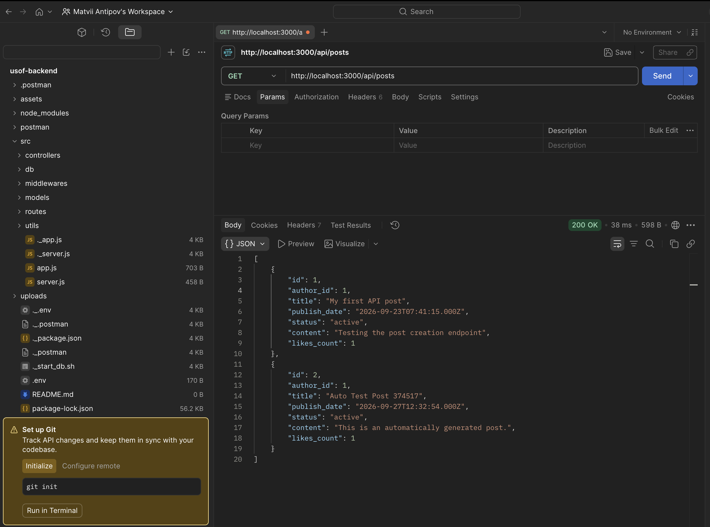
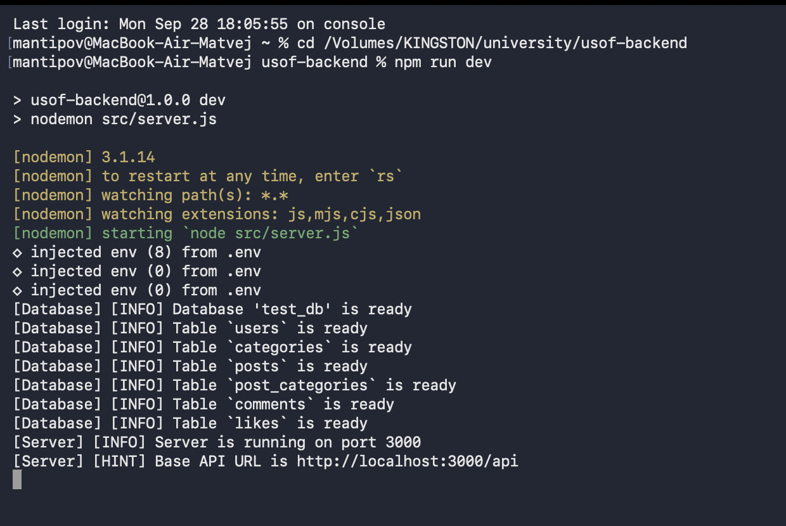

# USOF (Ucode Stack Overflow)

## Short description
**USOF (Ucode Stack Overflow)** is a full-stack Q&A web application for developers similar to Stack Overflow, combining an interactive single-page frontend interface with a RESTful backend API service. The platform manages user registration, JWT-based authentication, password recovery via email, creating and categorizing technical questions, nested comment discussions with Markdown and code blocks, an automated user rating system (likes/dislikes and community reactions), content pagination, and role-based administration. Built with **React** and **Redux Toolkit** on the client side and **Node.js**, **Express**, and **MySQL** (using raw SQL queries without ORMs) on the server side.


*An example of an API request via Postman showing the project in use.*


*Terminal logs.*

## Requirements and dependencies
The following components must be installed on your machine to build and run the project:

**System Requirements:**
* Node.js (v18 or higher)
* MySQL Server (v8 or higher)
* Modern web browser (Chrome, Firefox, Safari, or Edge)
* A Mailtrap account for testing the password reset functionality

**NPM Dependencies (Frontend):**
* `react` & `react-dom` — Component-based library for building the user interface.
* `@reduxjs/toolkit` & `react-redux` — Centralized state management and asynchronous thunks (`authSlice`, `postsSlice`).
* `axios` — HTTP client with request/response interceptors for communicating with the REST API.
* `react-scripts` — Build, bundling, and development server tooling with API proxy support.

**NPM Dependencies (Backend — `./api`):**
* `express` — Web framework for routing.
* `mysql2` — MySQL driver for executing database queries.
* `bcrypt` — Utility for secure password hashing.
* `jsonwebtoken` — Generates and verifies JWT tokens for authorization.
* `multer` — Middleware for handling image uploads.
* `nodemailer` — Module for sending emails.
* `dotenv` — Manages environment variables.
* `nodemon` (dev) — Automatically restarts the server during development.

## How to run the solution
Follow these steps from cloning the repository to the first launch of the full-stack application:

1. **Clone the repository:**
   ```bash
   git clone ssh://git@git.green-lms.app:22022/challenge-665/mantipov-12264.git
   ```
2. **Install and configure the Backend API (`./api`):**
   ```bash
   cd api
   npm install
   ```
   Create a `.env` file inside the `api/` directory and add the following variables:
   ```env
   PORT=3000
   DB_HOST=localhost
   DB_USER=root
   DB_PASSWORD=your_password
   DB_NAME=test_db
   JWT_SECRET=your_secret_key
   SMTP_USER=your_mailtrap_user
   SMTP_PASSWORD=your_mailtrap_password
   ```
3. **Start the Backend server:**
   The database schema and required tables will be initialized automatically upon startup on `http://localhost:3000`.
   ```bash
   npm run dev
   ```
4. **Install and start the Frontend application:**
   Open a new terminal window in the root project directory (`usof-frontend/`):
   ```bash
   npm install
   PORT=3001 npm start
   ```
   The web application will open in your browser at `http://localhost:3001` and automatically proxy `/api` and `/uploads` requests to `http://localhost:3000`.

## Full-fledged documentation

### Description of progress after every competed CBL stage
The development process followed the Challenge Based Learning framework:

* **Engage:** Analyzed the functional and UX requirements for a developer Q&A platform. Designed the full-stack architecture connecting a responsive React + Redux single-page application (SPA) with an MVC RESTful backend (`./api`) backed by a relational MySQL database. Planned the component hierarchy (`Header`, `Sidebar`, `PostFeed`, `PostPage`, `ProfilePage`, `AskQuestionModal`, `AuthModal`, `Footer`) and role permissions for Guests, Users, and Administrators.
* **Investigate:** Researched SPA state synchronization using Redux Toolkit and asynchronous thunks, JWT session persistence, and Axios interceptors for token injection and automatic expiration handling. Investigated client-side input validation, responsive Flexbox/Grid layouts across mobile, tablet, and desktop viewports, pagination strategies (numbered pages vs. endless scrolling), and secure backend interaction using prepared SQL statements in `mysql2/promise`, `multer` avatar uploads, and `nodemailer` SMTP recovery flows.
* **Act:** Implemented the complete frontend interface and integrated all backend API endpoints. Built the global header with instant search, language switcher (UA/EN), user role/login/avatar display, and logout control on every view. Implemented the main question feed with sorting (by date or likes), filtering (by category, date interval, and active/inactive status), configurable pagination, and top-answer previews. Created the full question page with nested comment replies, ascending/descending like sorting, Markdown code blocks, image attachments, social sharing, bookmarks, and platform statistics, as well as the user profile and administrator management panels.

### Description of the algorithm of the whole program
The full-stack application operates based on the following algorithm:

1. **Startup & Database Initialization:** When the backend server starts (`api/src/server.js`), it executes `initDB()`, connecting to MySQL and automatically creating the database and relational tables (`users`, `categories`, `posts`, `post_categories`, `comments`, `likes`) if they do not exist. The Express server then listens on port `3000`.
2. **Client Initialization & Session Hydration:** When the user opens the React application (`src/index.js` -> `MainPage.jsx`), the Redux store (`authSlice` and `postsSlice`) initializes. The client checks `localStorage` for an active JWT token, verifies its expiration, and dispatches `verifySession()` (`GET /api/users/:id`) and `checkApiHealth()` (`GET /api`) to hydrate the authenticated user's profile and confirm API connectivity.
3. **Feed Loading, Filtering & Pagination:** `PostFeed` dispatches `fetchCategories()` (`GET /api/categories`) and `fetchPosts()` (`GET /api/posts`) with sorting (`date` or `likes`), sort order (`DESC`/`ASC`), category filter, date range (`startDate`/`endDate`), and status parameters. For visible publications, `fetchPostPreviewComments()` loads associated categories (`GET /api/posts/:id/categories`), comments (`GET /api/posts/:id/comments`), and vote scores (`GET /api/posts/:id/like`), rendering bounded previews and paginating results via either page numbers or endless scrolling.
4. **Request Interception & Middleware Processing:** When a user performs a protected action (creating/editing a post, commenting, voting, updating profile data, or using the admin panel), the centralized Axios client (`src/api/client.js`) attaches the `Authorization: Bearer <token>` header. On the backend, `authMiddleware` (`verifyToken`, `optionalAuth`, `isAdmin`) validates the JWT signature and checks role permissions, returning `401` or `403` if unauthorized.
5. **Controllers & Database Persistence:** Validated requests reach the corresponding Express controllers (`AuthController`, `UserController`, `PostController`, `CategoryController`, `CommentController`, `LikeController`), which invoke model methods (`api/src/models/`) to execute parameterized SQL queries against the MySQL connection pool and return JSON responses.
6. **Reactive State Update & UI Rendering:** Upon receiving the HTTP response, Redux Toolkit `extraReducers` update the normalized client state (`items`, `categories`, `currentPostComments`, `postLikesMap`, `commentLikesMap`, `usersMap`), dynamically recalculating user ratings and triggering immediate re-renders and toast notifications without reloading the browser page.
