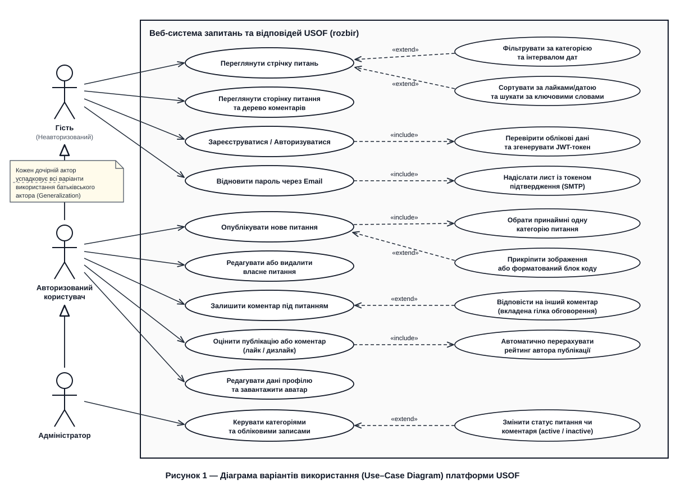
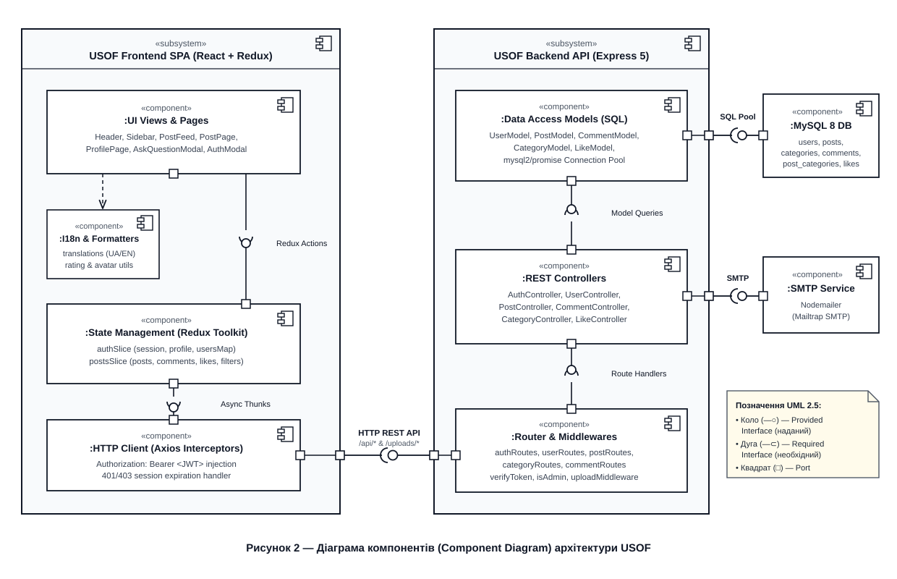
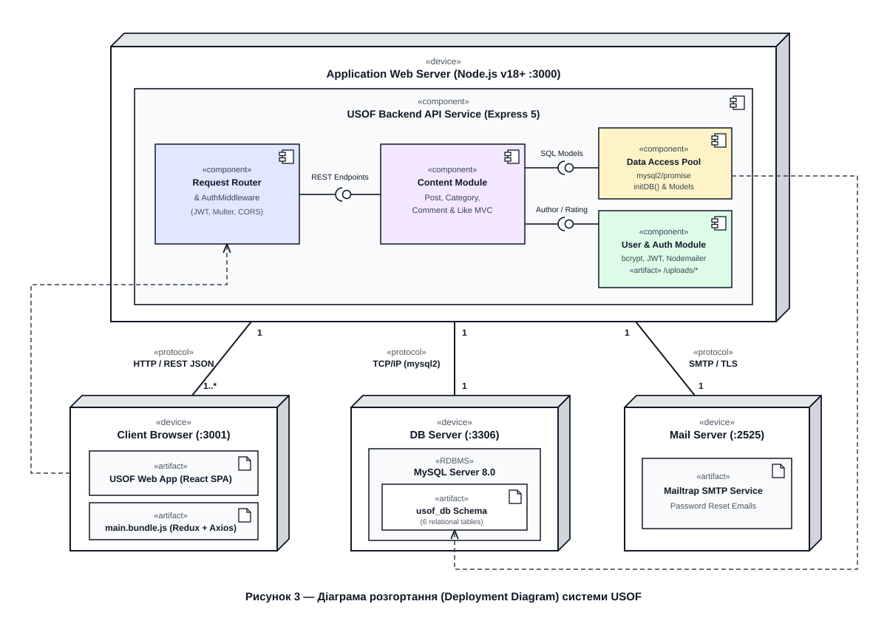
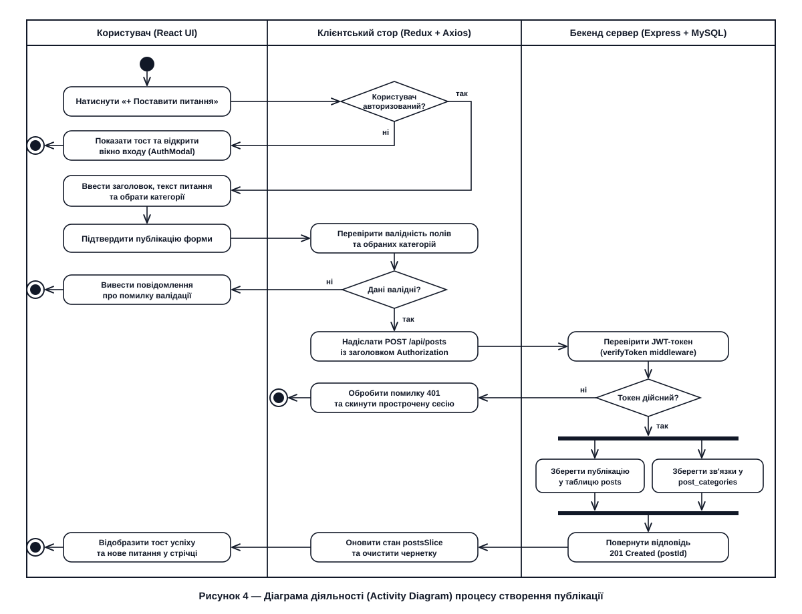
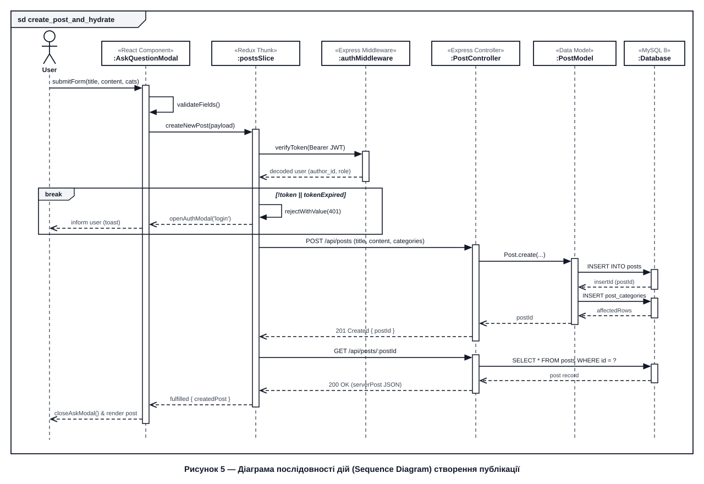
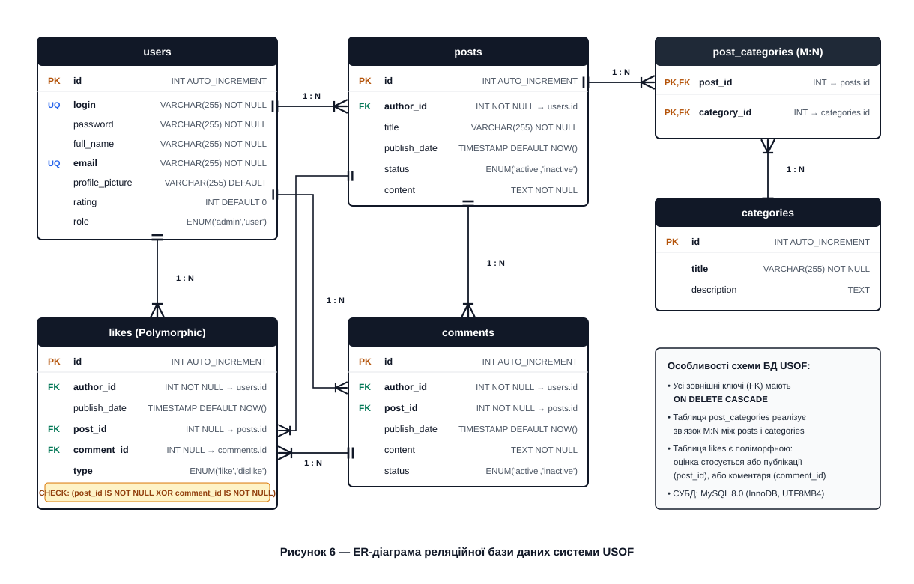

# USOF (rozbir)

## Short description
**USOF (rozbir)** is a full-stack Q&A web application for developers similar to Stack Overflow. The project combines a single-page React frontend with a Node.js and Express REST API. Users can register, log in with JWT, recover passwords via email, ask questions, select categories, write comments and replies, vote with likes and dislikes, bookmark posts, and manage their profile. The backend uses MySQL with raw SQL queries without any ORM.


*Postman request example.*


*Server terminal logs.*

## Technology stack
* **Frontend:** React 19, Redux Toolkit, React-Redux, Axios, CSS (Flexbox / Grid).
* **Backend:** Node.js (v18+), Express 5.
* **Database:** MySQL 8.0 (`mysql2/promise` connection pool, raw SQL queries).
* **Authentication & Security:** JSON Web Tokens (`jsonwebtoken`), `bcrypt` password hashing.
* **Files & Mail:** `multer` for avatar uploads, `nodemailer` (Mailtrap SMTP) for password reset emails.

## Requirements and dependencies
To run the project locally you need:
* Node.js (v18 or higher)
* MySQL Server (v8.0 or higher)
* Web browser (Chrome, Firefox, Safari, or Edge)
* Mailtrap account (for password reset emails)

**Frontend dependencies (`package.json`):**
* `react`, `react-dom` - UI components and rendering
* `@reduxjs/toolkit`, `react-redux` - state management (`authSlice`, `postsSlice`)
* `axios` - HTTP requests to the backend API
* `react-scripts` - dev server and build scripts

**Backend dependencies (`api/package.json`):**
* `express` - routing and middleware
* `mysql2` - MySQL connection pool and queries
* `bcrypt` - password hashing
* `jsonwebtoken` - JWT generation and verification
* `multer` - avatar file uploads
* `nodemailer` - sending password reset emails
* `dotenv` - environment variables
* `nodemon` - auto-restart during development

## How to run the solution
1. **Clone the repository:**
   ```bash
   git clone ssh://git@git.green-lms.app:22022/challenge-665/mantipov-12264.git
   ```
2. **Set up the backend (`./api`):**
   ```bash
   cd api
   npm install
   cp .env.example .env
   ```
   Configure database and mail credentials inside `api/.env`:
   ```env
   PORT=3000
   DB_HOST=localhost
   DB_USER=root
   DB_PASSWORD=your_password
   DB_NAME=test_db
   JWT_SECRET=your_secret_key
   SMTP_USER=your_mailtrap_user
   SMTP_PASSWORD=your_mailtrap_password
   ```
3. **Start the backend server:**
   Tables and test data (at least 5 entries per each table) are created automatically on startup (`http://localhost:3000`).
   ```bash
   npm run dev
   ```

4. **Start the frontend (`usof-frontend/`):**
   Open a second terminal in the project root:
   ```bash
   cp .env.example .env
   npm install
   npm start
   ```
   Open `http://localhost:3001` in the browser. Setting `PORT=3001` in `.env` (copied from `.env.example`) provides cross-platform compatibility across Windows (PowerShell / Command Prompt), macOS, and Linux without port conflict with the backend. Requests to `/api` and `/uploads` are automatically proxied to `http://localhost:3000`.

### Database initialization and test data
To fulfill the requirement of having at least five entries per each table, the project provides three flexible options:
1. **Automatic Seeding on Startup:** On the first launch of the backend (`npm run dev`), `initDB()` creates the database schema and automatically populates test entries across all tables if the `users` table is empty.
2. **Dedicated CLI Seed Script:** Run the seed command inside the `api/` directory at any time:
   ```bash
   cd api
   npm run seed
   ```
3. **Standalone SQL File:** A portable SQL dump file `db_seed.sql` (and `api/db_seed.sql`) is included for direct import via MySQL CLI or GUI tools (Workbench, HeidiSQL, phpMyAdmin):
   ```bash
   mysql -u root -p test_db < db_seed.sql
   ```

**Pre-configured Demo Accounts (all passwords: `password123`):**
| Role | Username | Password | Email | Rating |
|---|---|---|---|---|
| **Admin** | `admin` | `password123` | `admin@usof.dev` | 120 |
| **User** | `alex_kovalenko` | `password123` | `alex@usof.dev` | 45 |
| **User** | `olena_m` | `password123` | `olena@usof.dev` | 38 |
| **User** | `dmytro_dev` | `password123` | `dmytro@usof.dev` | 22 |
| **User** | `maria_k` | `password123` | `maria@usof.dev` | 15 |
| **User** | `ivan_ts` | `password123` | `ivan@usof.dev` | 8 |

## Non-functional requirements

1. **Performance**
   * API response time for standard requests (`GET /api/posts`, `POST /api/posts`, `POST /api/posts/:id/like`) stays under 200 ms under normal load and under 1.5 s with up to 500 concurrent users.
   * Initial page load takes less than 2.5 s on a 10 Mbps connection.
   * Avatar uploads and inline question images are limited to 2.5 MB.
   * *Verification:* Chrome DevTools (Network and Lighthouse tabs) and Postman response timings.

2. **Security**
   * User passwords are stored as `bcrypt` hashes (10 salt rounds).
   * Protected endpoints require a valid JWT token (24-hour expiration) passed in the `Authorization: Bearer <token>` header.
   * Role checks (`user`, `admin`) and resource ownership checks are enforced on the server in `authMiddleware` and controllers.
   * All SQL queries use parameterized statements (`?`) to prevent SQL injection.
   * *Verification:* testing protected routes without a token (401) and without admin permissions (403) in Postman.

3. **Reliability**
   * Foreign keys in MySQL tables use `ON DELETE CASCADE`, and the `likes` table includes a `CHECK` constraint to keep data consistent.
   * On server startup, `initDB()` automatically creates the database and all 6 tables if they do not exist.
   * Question drafts are saved in `localStorage` so unsent text is not lost on page reload.
   * *Verification:* restarting the server and checking data persistence in MySQL and draft recovery in the browser.

4. **Scalability**
   * The API does not store sessions in memory (JWT is used), allowing multiple Node.js instances to run behind a load balancer.
   * The question feed supports pagination with selectable page sizes (5, 10, 20, 50) as well as a load-more mode.
   * *Verification:* testing the feed with different `page` and `limit` values.

5. **Usability**
   * Responsive layout for desktop screens, tablets (up to 900 px), and mobile phones (up to 520 px).
   * Two interface languages (Ukrainian and English) with instant switching in the header.
   * Form validation with clear error messages and toast notifications. The target System Usability Scale (SUS) score is above 75/100, and core elements follow WCAG 2.1 Level A.
   * *Verification:* Chrome DevTools device toolbar (`375px`, `768px`, `1440px`) and form validation checks.

## UML diagrams and database schema

### 1. Use-Case Diagram


### 2. Component Diagram


### 3. Deployment Diagram


### 4. Activity Diagram


### 5. Sequence Diagram


### 6. Database Schema


## Full-fledged documentation

### Description of progress after every completed CBL stage
* **Engage:** Studied the task requirements for the frontend and backend parts of USOF. Planned the page structure (`Header`, `Sidebar`, `PostFeed`, `PostPage`, `ProfilePage`, `AskQuestionModal`, `AuthModal`, `Footer`), user roles (Guest, User, Admin), and UML diagrams for the project.
* **Investigate:** Chose Redux Toolkit for managing application state and Axios for API requests. Looked into JWT token handling on the client, form validation rules, pagination options, nested comment replies, and responsive CSS layout for mobile and desktop screens.
* **Act:** Built all components and connected them to the Express + MySQL API. Added sorting by likes and date, filtering by category, date interval, and status, pagination (pages and load more), question creation and editing with code blocks and images, nested comments, voting and rating calculation, user profile editing with avatar upload, and admin tools for managing users and categories.

### Description of the algorithm of the whole program
1. **Database and server startup:** When `api/src/server.js` starts, `initDB()` connects to MySQL and creates the database and tables (`users`, `categories`, `posts`, `post_categories`, `comments`, `likes`) if they do not exist. After that, Express starts listening on port `3000`.
2. **App initialization:** When the browser opens the React app (`src/index.js` -> `MainPage.jsx`), Redux initializes `authSlice` and `postsSlice`. If a JWT token is found in `localStorage`, the app checks its expiration and requests the current user's profile (`GET /api/users/:id`).
3. **Loading the feed:** `PostFeed` loads categories (`GET /api/categories`) and posts (`GET /api/posts`), applying the selected sort order, category filter, date interval, and pagination settings. For visible posts, it also fetches their categories, comment count/preview, and like score.
4. **Sending authenticated requests:** When an authorized user creates a post, leaves a comment, votes, or edits their profile, the Axios interceptor in `src/api/client.js` adds the `Authorization: Bearer <token>` header. On the backend, `authMiddleware` checks the token and user role, returning `401` or `403` if access is denied.
5. **Database queries:** The matching controller (`AuthController`, `UserController`, `PostController`, `CategoryController`, `CommentController`, `LikeController`) validates input data and calls model methods (`api/src/models/`) to run SQL queries through the MySQL pool.
6. **Updating the UI:** After the server responds with JSON, Redux updates the store state, recalculates user ratings, shows a notification toast, and re-renders the updated components on screen.
